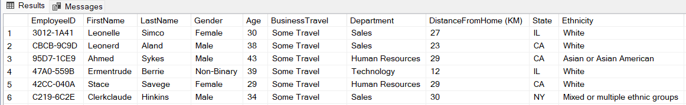

# Proyecto1 Ventas
## Resumen (Overview)
El personal de recursos humanos de **GreatPlaceToWork** desea mejorar el desempeño, aumentar la retención y mejorar la satisfacción laboral general. Sin embargo, no cuentan con una visión clara de los datos pertinentes de los empleados. Mi objetivo es utilizar **SQL** dentro de **DATABRICKS**, analizando sus datos para proporcionar recomendaciones al departamento de RR.HH. que faciliten mejoras exitosas.

## 📩 Si quieres aprender SQL Conéctate conmigo

  

## Estructura del Proyecto

- [Sobre los Datos](#sobre-los-datos)
- [Tareas](#tareas)
- [Limpieza de Datos](#limpieza-de-datos)
- [Análisis Exploratorio de Datos e Insights](#análisis-exploratorio-de-datos-e-insights)

## Sobre los Datos

Los datos originales, junto con una explicación de cada columna, se pueden encontrar [aquí](https://www.kaggle.com/datasets/rohitgrewal/restaurant-sales-data/data?select=9.+Sales-Data-Analysis.csv).

El conjunto de datos incluye cinco tablas que capturan evaluaciones de desempeño, datos demográficos de los empleados, niveles de satisfacción y calificaciones, distribuidos en más de 8,100 registros y 40 columnas.

## Tareas (Task) (aca hacer las preguntas y el prompt)

En este análisis, ayudo al departamento de RR.HH. a responder lo siguiente:

1. **Antigüedad:** ¿Cuál es el promedio de antigüedad de los empleados en cada departamento?
2. **Retención:** ¿Cuántos empleados en cada departamento siguen trabajando actualmente en la empresa?
3. **Satisfacción vs. Antigüedad:** ¿Cómo se compara la satisfacción laboral de los empleados en diferentes niveles de antigüedad?
4. **Horas Extras:** ¿Qué porcentaje de empleados que trabajan horas extras han dejado la empresa?
5. **Desempeño por Viajes:** Clasificar los departamentos por el promedio de calificación de los gerentes, desglosado por frecuencia de viajes de negocios.
6. **Capacitación:** ¿Existe una correlación positiva entre el número de oportunidades de capacitación tomadas y la satisfacción laboral?
7. **Talento Top:** Identificar a los tres mejores empleados según la calificación de su gerente en cada departamento.
8. **Distancia al Trabajo:** Categorizar a los empleados según su distancia al trabajo y mostrar el promedio de satisfacción laboral en cada categoría.
9. **Promociones y Liderazgo:** ¿Existe una relación entre el número de ascensos y los años que un empleado ha pasado con su gerente actual?
10. **Alerta de Rotación:** Para cada departamento, identificar el porcentaje de empleados que se han ido y que tenían una puntuación de satisfacción laboral inferior a 3.