# Proyecto1 Ventas
## Resumen (Overview)
El área comercial de la empresa busca comprender mejor el comportamiento de sus ventas, identificar los productos y canales de compra con mayor rendimiento, y evaluar los resultados por ciudad y responsable comercial. Sin embargo, necesita transformar sus registros de ventas en información relevante que facilite la identificación de tendencias y oportunidades de mejora. Mi objetivo es utilizar Databricks SQL para explorar, limpiar y analizar los datos mediante consultas que incorporen CTEs, Window Functions y CASE WHEN, con el fin de calcular indicadores clave de rendimiento (KPIs), evaluar el desempeño comercial y generar conclusiones y recomendaciones basadas en datos que contribuyan a una mejor toma de decisiones.

## 📩 Si quieres aprender SQL Conéctate conmigo
<p align="center">
  <a href="https://www.linkedin.com/in/heigner-sandoval-728831285/">
    
  </a>

## Estructura del Proyecto

- [Sobre los Datos](#sobre-los-datos)
- [Tareas](#tareas)
- [Limpieza de Datos](#limpieza-de-datos)
- [Análisis Exploratorio de Datos e Insights](#análisis-exploratorio-de-datos-e-insights)

## Sobre los Datos

Los datos originales, junto con una explicación de cada columna, se pueden encontrar [aquí](https://www.kaggle.com/datasets/rohitgrewal/restaurant-sales-data/data?select=9.+Sales-Data-Analysis.csv).

El conjunto de datos incluye una tabla que capturan los identificadores de pedidos, la fecha de venta, los productos vendidos, precio unitario, cantidad vendida, canal de compra, metodos de pago, el responsable o gerente, cuidad de la venta distribuidos en 254 registros y 9 columnas. La información corresponde a ventas registradas entre el 7 de noviembre y el 29 de diciembre de 2022. 


## Tareas (Task)

En este análisis, ayudo al departamento de ventas. a responder lo siguiente:

1. **DIAGNOSTICO GENERAL** 
      - ¿Cuál es el ingreso total generado durante el periodo analizado?
      - ¿Qué productos generan mayores ingresos y cuáles registran mayor cantidad vendida?
      - ¿Qué ciudad genera mayores ingresos y cuál registra más ventas?
      - Qué método de pago es el más utilizado y qué participación tiene en los ingresos?
      - ¿Qué canal de compra genera más ingresos?

2. **RENDIMIENTO COMERCIAL**
      - ¿Qué gerente genera mayores ingresos y cómo se distribuyen las ventas entre los responsables?
      - ¿Qué productos tienen el precio promedio más alto y cuáles presentan mayor variabilidad de precios?
      - ¿Qué combinación de ciudad y canal de compra genera más ingresos?
      - ¿Qué productos representan el 80 % de los ingresos acumulados?
      - ¿Qué gerentes tienen ingresos superiores al promedio de todos los gerentes?

3. **TENDENCIAS**
      - ¿Cómo evolucionan los ingresos diarios y qué días presentan el mayor crecimiento o caída respecto al día anterior?
      - ¿Qué productos lideran las ventas dentro de cada ciudad?
      - ¿Qué porcentaje de los ingresos totales aporta cada gerente y cómo cambia su posición en el ranking?
      - ¿Qué canales tienen un ingreso promedio por registro superior al promedio general?
      - ¿Qué combinación de producto, ciudad y canal presenta oportunidades de mejora comercial?

## Limpieza de Datos

Aunque el análisis principal utiliza ventas_limpias, conviene documentar cómo verificamos que los datos sean confiables antes de presentar los resultados.

Validación de fechas, precios y cantidades
 
```sql
SELECT
    COUNT(*) AS total_registros,

    SUM(CASE
        WHEN `Date` IS NULL THEN 1
        ELSE 0
    END) AS fechas_nulas,

    SUM(CASE
        WHEN Product IS NULL THEN 1
        ELSE 0
    END) AS productos_nulos,

    SUM(CASE
        WHEN Price IS NULL THEN 1
        ELSE 0
    END) AS precios_nulos,

    SUM(CASE
        WHEN Quantity IS NULL THEN 1
        ELSE 0
    END) AS cantidades_nulas,

    SUM(CASE
        WHEN Price < 0 OR Quantity < 0 THEN 1
        ELSE 0
    END) AS valores_negativos

FROM ventas_limpias;
```

Interpretación: los resultados permiten documentar la calidad de los datos utilizados en el análisis. Si aparecen valores nulos o negativos, debemos evaluar cómo tratarlos antes de calcular indicadores comerciales. No conviene eliminarlos automáticamente sin conocer su significado.

Comprobar posibles duplicados

-- Identificación de Order ID repetidos
```sql
SELECT
    `Order ID`,
    COUNT(*) AS cantidad_registros
FROM ventas_limpias
WHERE `Order ID` IS NOT NULL
GROUP BY `Order ID`
HAVING COUNT(*) > 1
ORDER BY cantidad_registros DESC;
```

Un Order ID repetido no necesariamente es un error: un pedido puede contener varios productos o líneas de venta. Antes de eliminar duplicados, debemos confirmar si cada fila representa una línea de pedido o un pedido completo.

## Análisis Exploratorio de Datos e Insights

### Pregunta #1: ¿Cuál es el ingreso total generado durante el periodo analizado?

ANALISIS

Para responder esta pregunta, utilicé la función SUM() para calcular los ingresos totales, multiplicando el precio de cada producto por su cantidad vendida. Este indicador me permitió obtener una visión general del comportamiento económico de las ventas durante el periodo analizado y establecer una referencia para las siguientes consultas.

```sql
SELECT
ROUND(SUM(Price * Quantity), 2) AS ingresos_totales
FROM bd_p1.default.`9_sales_data_analysis`;
```

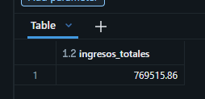

CONCLUSIONES

Con esta consulta pude conocer el ingreso total generado por las ventas registradas. Considero que este resultado es fundamental porque me proporciona una base para evaluar el rendimiento comercial y comparar los ingresos entre productos, ciudades, canales de compra y responsables de ventas.

### Pregunta #2: ¿Qué productos generan mayores ingresos y cuáles registran mayor cantidad vendida?

ANALISIS

Agrupé los registros por producto utilizando GROUP BY y calculé los ingresos totales mediante SUM(Price * Quantity). También sumé las cantidades vendidas y calculé el precio promedio con AVG(). De esta manera, pude comparar el rendimiento de cada producto desde dos perspectivas: su contribución económica y su volumen de ventas.

```sql
SELECT
    Product,
    SUM(Quantity) AS unidades_vendidas,
    ROUND(SUM(Price * Quantity), 2) AS ingresos_totales,
    ROUND(AVG(Price), 2) AS precio_promedio
FROM bd_p1.default.`9_sales_data_analysis`
GROUP BY Product
ORDER BY ingresos_totales DESC;
```

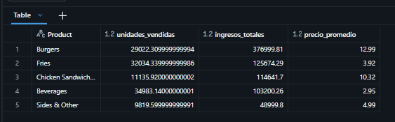

CONCLUSIONES

Esta consulta me permitió diferenciar los productos que generan mayores ingresos de aquellos que registran una mayor cantidad de unidades vendidas. Considero que ambas métricas son importantes, porque un producto puede destacar por su precio mientras que otro puede tener una demanda más elevada.

### Pregunta #3: Qué ciudad genera mayores ingresos y cuál registra más ventas?

ANALISIS
Utilicé GROUP BY para agrupar las ventas por ciudad y las funciones SUM() y COUNT() para comparar los ingresos y el volumen de actividad. También incorporé COUNT(DISTINCT Order ID) para distinguir los pedidos únicos de los registros individuales, ya que un pedido podría contener varias líneas de venta.

```sql
SELECT
    City,
    COUNT(*) AS registros_venta,
    COUNT(DISTINCT `Order ID`) AS pedidos_unicos,
    SUM(Quantity) AS unidades_vendidas,
    ROUND(SUM(Price * Quantity), 2) AS ingresos_totales
FROM bd_p1.default.`9_sales_data_analysis`
GROUP BY City
ORDER BY ingresos_totales DESC;
```

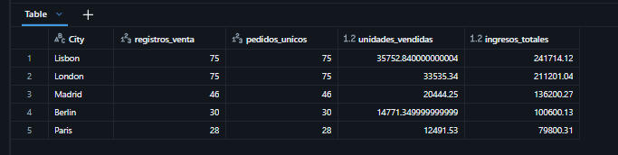

CONCLUSIONES

Mediante esta consulta pude comparar el desempeño comercial de las ciudades y diferenciar los mercados que generan más ingresos de aquellos que concentran más pedidos o registros. Este enfoque me permitió evaluar no solo el volumen de actividad, sino también la contribución económica de cada ciudad.

### Pregunta #4: ¿Qué método de pago es el más utilizado y qué participación tiene en los ingresos?

ANALISIS
Agrupé los registros por método de pago y calculé la cantidad de registros y los ingresos asociados a cada uno. Utilicé una CTE para obtener los ingresos totales y calcular el porcentaje que representa cada método sobre ese total.

```sql
WITH pagos AS (
    SELECT
        `Payment Method` AS metodo_pago,
        COUNT(*) AS registros,
        SUM(Price * Quantity) AS ingresos
    FROM bd_p1.default.`9_sales_data_analysis`
    GROUP BY `Payment Method`
),
total AS (
    SELECT SUM(ingresos) AS ingresos_totales
    FROM pagos
)
SELECT
    p.metodo_pago,
    p.registros,
    ROUND(p.ingresos, 2) AS ingresos,
    ROUND(
        100.0 * p.ingresos / NULLIF(t.ingresos_totales, 0),
        2
    ) AS participacion_ingresos_pct
FROM pagos p
CROSS JOIN total t
ORDER BY p.registros DESC;
```

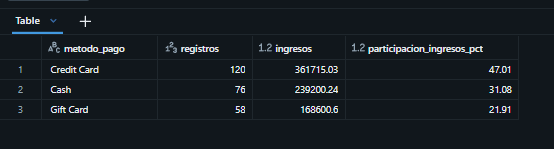

CONCLUSIONES

Esta consulta me permitió evaluar las preferencias de pago de los clientes y comparar la frecuencia de uso de cada método con su participación económica. Considero que esta distinción es importante porque el método más utilizado no necesariamente es el que concentra la mayor proporción de ingresos.

### Pregunta #5: ¿Qué canal de compra genera más ingresos?

ANALISIS
Agrupé las ventas por canal de compra utilizando la columna Purchase Type. Calculé los ingresos totales, las unidades vendidas y el ingreso promedio por registro para comparar tanto el volumen comercial como el valor económico promedio de las operaciones.

```sql
SELECT
    `Purchase Type` AS canal_compra,
    COUNT(*) AS registros_venta,
    SUM(Quantity) AS unidades_vendidas,
    ROUND(SUM(Price * Quantity), 2) AS ingresos_totales,
    ROUND(AVG(Price * Quantity), 2) AS ingreso_promedio_registro
FROM bd_p1.default.`9_sales_data_analysis`
GROUP BY `Purchase Type`
ORDER BY ingresos_totales DESC;
```

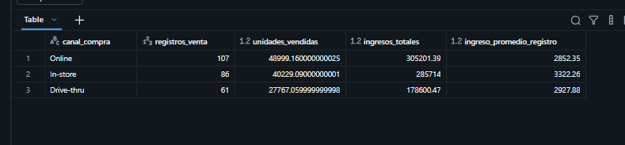

CONCLUSIONES

Con esta consulta pude comparar la contribución de los canales de compra a los ingresos del negocio. Además, el ingreso promedio por registro me permitió complementar el análisis y distinguir entre los canales que generan ingresos por un mayor volumen de actividad y aquellos que presentan operaciones de mayor valor promedio.

### Pregunta #6: ¿Qué gerente genera mayores ingresos y cómo se distribuyen las ventas entre los responsables?

ANALISIS
Agrupé los ingresos por gerente y utilicé una CTE para organizar los resultados. Después, apliqué SUM() OVER() para calcular la participación porcentual de cada responsable y DENSE_RANK() para establecer el ranking según los ingresos generados.

```sql
WITH ventas_gerente AS (
    SELECT
        Manager AS gerente,
        COUNT(*) AS registros_venta,
        SUM(Price * Quantity) AS ingresos
    FROM bd_p1.default.`9_sales_data_analysis`
    GROUP BY Manager
)
SELECT
    gerente,
    registros_venta,
    ROUND(ingresos, 2) AS ingresos,
    ROUND(
        100.0 * ingresos / NULLIF(SUM(ingresos) OVER (), 0),
        2
    ) AS participacion_pct,
    DENSE_RANK() OVER (
        ORDER BY ingresos DESC
    ) AS ranking_ingresos
FROM ventas_gerente
ORDER BY ingresos DESC;
```

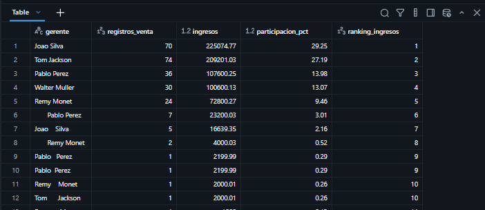

CONCLUSIONES

Esta consulta me permitió comparar el rendimiento comercial de los gerentes, identificar sus posiciones relativas y conocer la contribución de cada uno a los ingresos totales. Considero que combinar el ranking con la participación porcentual proporciona una visión más completa que observar únicamente el total de ingresos por responsable.

### Pregunta #7: ¿Qué productos tienen el precio promedio más alto y cuáles presentan mayor variabilidad de precios?

ANALISIS
Utilicé AVG(), MIN() y MAX() para calcular el precio promedio, mínimo y máximo por producto. Además, apliqué STDDEV_SAMP() para medir la dispersión de los precios registrados respecto a su promedio.

```sql
SELECT
    Product,
    ROUND(AVG(Price), 2) AS precio_promedio,
    ROUND(MIN(Price), 2) AS precio_minimo,
    ROUND(MAX(Price), 2) AS precio_maximo,
    ROUND(STDDEV_SAMP(Price), 2) AS desviacion_estandar
FROM  bd_p1.default.`9_sales_data_analysis`
WHERE Price IS NOT NULL
GROUP BY Product
ORDER BY precio_promedio DESC;
```

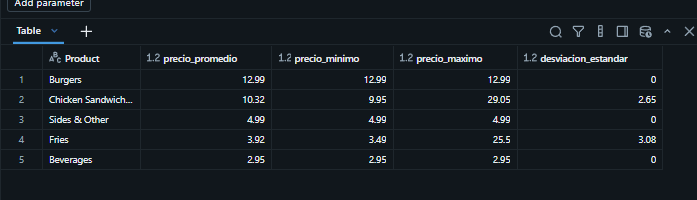

CONCLUSIONES

Mediante este análisis pude comparar los niveles de precios de los productos e identificar diferencias en su variabilidad. El precio promedio permite reconocer los productos con precios más elevados, mientras que la desviación estándar ayuda a detectar aquellos cuyos precios presentan una mayor dispersión.

### Pregunta #8: ¿Qué combinación de ciudad y canal de compra genera más ingresos?

ANALISIS
Agrupé los registros por ciudad y canal de compra, utilizando ambas columnas como dimensiones de análisis. Posteriormente, calculé los ingresos y las unidades vendidas para ordenar las combinaciones según su contribución económica.

```sql
SELECT
    City,
    `Purchase Type` AS canal_compra,
    COUNT(*) AS registros_venta,
    SUM(Quantity) AS unidades_vendidas,
    ROUND(SUM(Price * Quantity), 2) AS ingresos_totales
FROM bd_p1.default.`9_sales_data_analysis`
GROUP BY City, `Purchase Type`
ORDER BY ingresos_totales DESC;
```

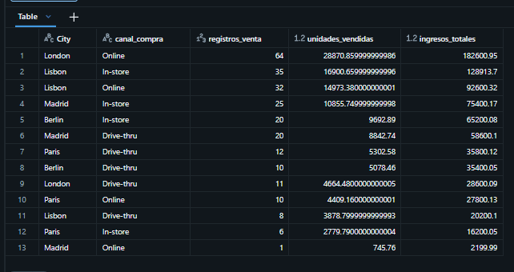

CONCLUSIONES

Esta consulta me permitió analizar el rendimiento comercial de forma más específica, relacionando el mercado geográfico con el canal de compra. Considero que este enfoque es útil porque permite observar diferencias que podrían pasar desapercibidas al analizar las ciudades o los canales por separado.

### Pregunta #9: ¿Qué productos representan el 80 % de los ingresos acumulados?

ANALISIS
Primero agrupé los ingresos por producto y después utilicé una función de ventana con SUM() OVER() para calcular los ingresos acumulados. Finalmente, dividí ese acumulado entre los ingresos totales para obtener el porcentaje acumulado de contribución de cada producto.

```sql
WITH ingresos_producto AS (
    SELECT
        Product,
        SUM(Price * Quantity) AS ingresos
    FROM bd_p1.default.`9_sales_data_analysis`
    GROUP BY Product
),
acumulado AS (
    SELECT
        Product,
        ingresos,
        SUM(ingresos) OVER (
            ORDER BY ingresos DESC, Product
            ROWS BETWEEN UNBOUNDED PRECEDING AND CURRENT ROW
        ) AS ingresos_acumulados,
        SUM(ingresos) OVER () AS ingresos_totales
    FROM ingresos_producto
)
SELECT
    Product,
    ROUND(ingresos, 2) AS ingresos,
    ROUND(ingresos_acumulados, 2) AS ingresos_acumulados,
    ROUND(
        100.0 * ingresos_acumulados
        / NULLIF(ingresos_totales, 0),
        2
    ) AS porcentaje_acumulado
FROM acumulado
ORDER BY ingresos DESC, Product;
```

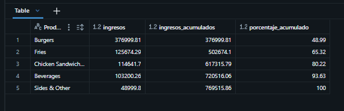

CONCLUSIONES

Este análisis me permitió ordenar los productos según su contribución económica y evaluar qué proporción de los ingresos se concentra en los primeros productos del ranking. Considero que el enfoque de Pareto es útil para comprender la distribución de los ingresos y comprobar si una parte relativamente pequeña del catálogo concentra una proporción importante de las ventas.

### Pregunta #10: ¿Qué gerentes tienen ingresos superiores al promedio de todos los gerentes?

ANALISIS
Calculé primero los ingresos totales de cada gerente. Luego utilicé AVG() OVER() para obtener el promedio de ingresos entre los gerentes incluidos en el análisis y filtré aquellos cuyos ingresos superaban esa referencia.producto.

```sql
WITH ventas_gerente AS (
    SELECT
        Manager AS gerente,
        SUM(Price * Quantity) AS ingresos
    FROM bd_p1.default.`9_sales_data_analysis`
    GROUP BY Manager
),
comparacion AS (
    SELECT
        gerente,
        ingresos,
        AVG(ingresos) OVER () AS promedio_gerentes
    FROM ventas_gerente
)
SELECT
    gerente,
    ROUND(ingresos, 2) AS ingresos,
    ROUND(promedio_gerentes, 2) AS promedio_gerentes,
    ROUND(ingresos - promedio_gerentes, 2) AS diferencia
FROM comparacion
WHERE ingresos > promedio_gerentes
ORDER BY ingresos DESC;
```

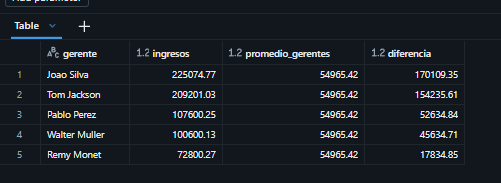

CONCLUSIONES

Esta consulta me permitió establecer una comparación entre los resultados individuales y el promedio general de los responsables comerciales. De esta forma, pude plantear un criterio cuantitativo para identificar a los gerentes que superan el promedio, complementando la información obtenida mediante el ranking de ingresos.

### Pregunta #11: ¿Cómo evolucionan los ingresos diarios y qué días presentan el mayor crecimiento o caída respecto al día anterior?

ANALISIS
Agrupé las ventas por fecha para calcular los ingresos diarios y utilicé la función LAG() para comparar cada fecha con la fecha registrada anterior. También calculé la variación monetaria y porcentual y utilicé CASE WHEN para clasificar el comportamiento como crecimiento, caída o ausencia de variación.

```sql
WITH ventas_diarias AS (
    SELECT
        TO_DATE(`Date`) AS fecha,
        SUM(Price * Quantity) AS ingresos
    FROM bd_p1.default.`9_sales_data_analysis`
    WHERE `Date` IS NOT NULL
    GROUP BY TO_DATE(`Date`)
),
comparacion AS (
    SELECT
        fecha,
        ingresos,
        LAG(ingresos) OVER (
            ORDER BY fecha
        ) AS ingresos_dia_anterior
    FROM ventas_diarias
)
SELECT
    fecha,
    ROUND(ingresos, 2) AS ingresos,
    ROUND(ingresos_dia_anterior, 2) AS ingresos_dia_anterior,
    ROUND(
        ingresos - ingresos_dia_anterior, 2
    ) AS variacion_ingresos,
    ROUND(
        100.0 * (ingresos - ingresos_dia_anterior)
        / NULLIF(ingresos_dia_anterior, 0),
        2
    ) AS variacion_porcentual,
    CASE
        WHEN ingresos > ingresos_dia_anterior THEN 'Crecimiento'
        WHEN ingresos < ingresos_dia_anterior THEN 'Caida'
        ELSE 'Sin variacion'
    END AS comportamiento
FROM comparacion
ORDER BY fecha;
```

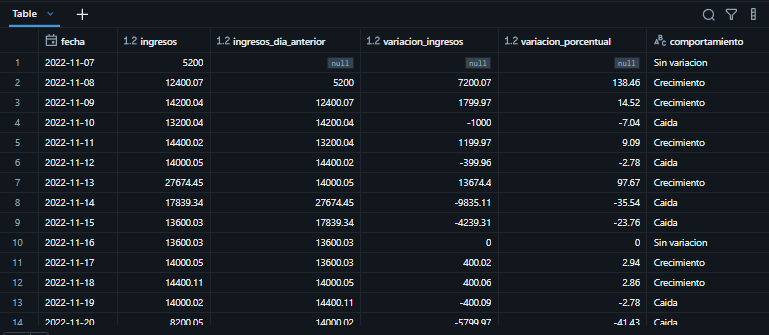

CONCLUSIONES

Este análisis me permitió estudiar los cambios diarios de los ingresos e identificar los periodos con mayores incrementos o disminuciones. Considero que la comparación temporal es importante porque ayuda a reconocer fluctuaciones en la actividad comercial y a localizar fechas que merecen una investigación más detallada.

### Pregunta #12: ¿Qué productos lideran las ventas dentro de cada ciudad?

Análisis

Agrupé los ingresos y las unidades vendidas por producto y ciudad. Posteriormente, utilicé RANK() junto con PARTITION BY City para calcular la posición de cada producto dentro de su propia ciudad y seleccionar los que ocupaban el primer lugar según los ingresos.

```sql
WITH ventas_producto_ciudad AS (
    SELECT
        City,
        Product,
        SUM(Quantity) AS unidades_vendidas,
        SUM(Price * Quantity) AS ingresos
    FROM bd_p1.default.`9_sales_data_analysis`
    GROUP BY City, Product
),
ranking AS (
    SELECT
        City,
        Product,
        unidades_vendidas,
        ingresos,
        RANK() OVER (
            PARTITION BY City
            ORDER BY ingresos DESC
        ) AS ranking_producto
    FROM ventas_producto_ciudad
)
SELECT
    City,
    Product,
    unidades_vendidas,
    ROUND(ingresos, 2) AS ingresos,
    ranking_producto
FROM ranking
WHERE ranking_producto = 1
ORDER BY City;
```

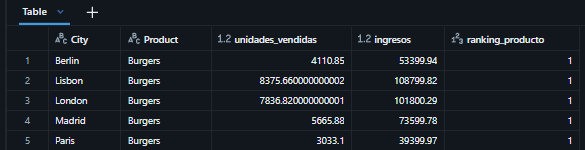

CONCLUSIONES

Esta consulta me permitió identificar los productos con mayores ingresos en cada ciudad y comparar el comportamiento comercial entre los diferentes mercados. Considero que el análisis por ciudad aporta una perspectiva más detallada, porque los productos destacados pueden variar según las características de cada mercado.

### Pregunta #13: ¿Qué porcentaje de los ingresos totales aporta cada gerente y cómo cambia su posición en el ranking?

Análisis

Agrupé los ingresos por gerente y mes, calculé la participación porcentual de cada responsable dentro de los ingresos mensuales y apliqué DENSE_RANK() para establecer su posición. Después, utilicé LAG() para comparar el ranking de cada gerente con el del periodo anterior.

```sql
WITH ventas_mensuales AS (
    SELECT
        DATE_TRUNC('MONTH', TO_DATE(`Date`)) AS mes,
        Manager AS gerente,
        SUM(Price * Quantity) AS ingresos
    FROM bd_p1.default.`9_sales_data_analysis`
    WHERE `Date` IS NOT NULL
    GROUP BY
        DATE_TRUNC('MONTH', TO_DATE(`Date`)),
        Manager
),
ranking AS (
    SELECT
        mes,
        gerente,
        ingresos,
        ROUND(
            100.0 * ingresos
            / NULLIF(SUM(ingresos) OVER (PARTITION BY mes), 0),
            2
        ) AS participacion_pct,
        DENSE_RANK() OVER (
            PARTITION BY mes
            ORDER BY ingresos DESC
        ) AS ranking_mensual
    FROM ventas_mensuales
),
comparacion AS (
    SELECT
        *,
        LAG(ranking_mensual) OVER (
            PARTITION BY gerente
            ORDER BY mes
        ) AS ranking_mes_anterior
    FROM ranking
)
SELECT
    mes,
    gerente,
    ROUND(ingresos, 2) AS ingresos,
    participacion_pct,
    ranking_mensual,
    ranking_mes_anterior,
    CASE
        WHEN ranking_mes_anterior IS NULL
            THEN 'Sin periodo anterior'
        WHEN ranking_mensual < ranking_mes_anterior
            THEN 'Subio en el ranking'
        WHEN ranking_mensual > ranking_mes_anterior
            THEN 'Bajo en el ranking'
        ELSE 'Mantuvo su posicion'
    END AS evolucion_ranking
FROM comparacion
ORDER BY mes, ranking_mensual;
      
```

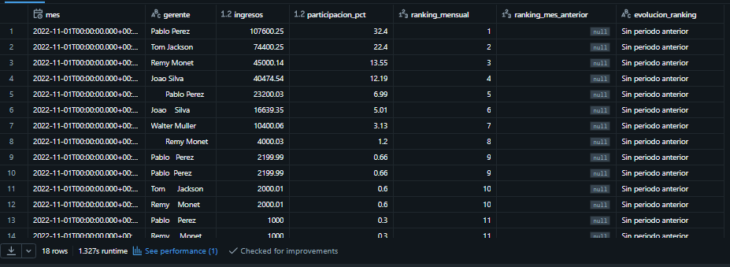

CONCLUSIONES

Este análisis me permitió estudiar tanto la contribución económica de cada gerente como la evolución de su posición relativa entre meses. Considero que comparar los rankings mensuales proporciona una visión más dinámica del desempeño comercial, ya que permite identificar cambios que no serían evidentes al observar únicamente los ingresos acumulados.

### Pregunta #14: ¿Qué canales tienen un ingreso promedio por registro superior al promedio general?

Análisis

Calculé el ingreso promedio por registro para cada canal y lo comparé con el promedio de todos los registros de venta. Utilicé CTEs para separar el cálculo por canal del promedio general y filtré los resultados que superaban esa referencia

```sql
WITH promedio_canal AS (
    SELECT
        `Purchase Type` AS canal_compra,
        COUNT(*) AS registros,
        AVG(Price * Quantity) AS ingreso_promedio
    FROM bd_p1.default.`9_sales_data_analysis`
    GROUP BY `Purchase Type`
),
promedio_general AS (
    SELECT
        AVG(Price * Quantity) AS promedio_general
    FROM bd_p1.default.`9_sales_data_analysis`
)
SELECT
    c.canal_compra,
    c.registros,
    ROUND(c.ingreso_promedio, 2) AS ingreso_promedio,
    ROUND(g.promedio_general, 2) AS promedio_general,
    ROUND(
        c.ingreso_promedio - g.promedio_general, 2
    ) AS diferencia_promedio
FROM promedio_canal c
CROSS JOIN promedio_general g
WHERE c.ingreso_promedio > g.promedio_general
ORDER BY c.ingreso_promedio DESC;
      
```

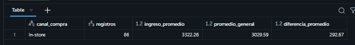

CONCLUSIONES

Esta consulta me permitió identificar los canales cuyo ingreso promedio por registro es superior al promedio general del conjunto de datos. Considero que este indicador complementa el análisis de ingresos totales porque ayuda a distinguir entre los canales con mayor volumen de actividad y aquellos que presentan operaciones de mayor valor promedio.

### Pregunta #15: ¿Qué combinación de producto, ciudad y canal presenta oportunidades de mejora comercial?

Análisis

Agrupé las ventas por producto, ciudad y canal de compra para obtener indicadores específicos de cada combinación. Después utilicé funciones de ventana para calcular los promedios de unidades vendidas y de ingreso por registro entre las combinaciones analizadas. Finalmente, apliqué CASE WHEN para clasificar los resultados según su posición respecto a esos promedios.

```sql
WITH rendimiento AS (
    SELECT
        Product,
        City,
        `Purchase Type` AS canal_compra,
        COUNT(*) AS registros,
        SUM(Quantity) AS unidades_vendidas,
        SUM(Price * Quantity) AS ingresos,
        AVG(Price * Quantity) AS ingreso_promedio
    FROM bd_p1.default.`9_sales_data_analysis`
    GROUP BY Product, City, `Purchase Type`
),
referencias AS (
    SELECT
        *,
        AVG(unidades_vendidas) OVER () AS promedio_unidades,
        AVG(ingreso_promedio) OVER () AS promedio_ingreso
    FROM rendimiento
)
SELECT
    Product,
    City,
    canal_compra,
    registros,
    unidades_vendidas,
    ROUND(ingresos, 2) AS ingresos,
    ROUND(ingreso_promedio, 2) AS ingreso_promedio,
    CASE
        WHEN unidades_vendidas >= promedio_unidades
             AND ingreso_promedio < promedio_ingreso
            THEN 'Revisar valor promedio de compra'
        WHEN unidades_vendidas < promedio_unidades
             AND ingreso_promedio >= promedio_ingreso
            THEN 'Impulsar volumen de ventas'
        WHEN unidades_vendidas < promedio_unidades
             AND ingreso_promedio < promedio_ingreso
            THEN 'Priorizar investigacion comercial'
        ELSE 'Mantener y evaluar resultados'
    END AS oportunidad_comercial
FROM referencias
ORDER BY ingresos DESC;
      
```

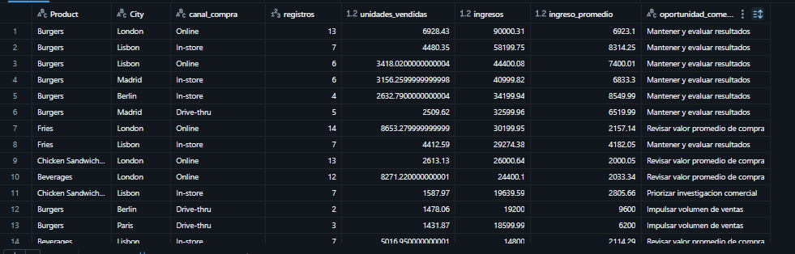

CONCLUSIONES

Este análisis me permitió integrar varias dimensiones comerciales en una sola consulta e identificar combinaciones que podrían requerir diferentes estrategias de mejora. Considero que es una de las preguntas más útiles del proyecto porque no se limita a describir las ventas, sino que ayuda a generar hipótesis sobre dónde investigar oportunidades comerciales.
